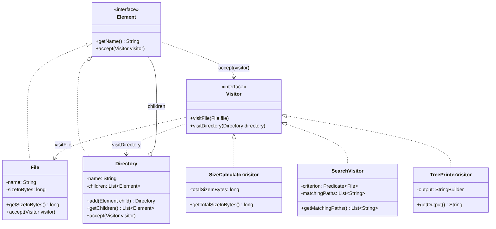

# Assignment #6 — Visitor Pattern: Report

Student: Kosaman Madiyar

## 1. Introduction
I chose **Option A: File System Visitor**. The object structure is a tree of `File` (leaf) and
`Directory` (composite, holds `File`s and other `Directory`s). The structure is stable, but we need
several unrelated operations on it. Instead of adding methods to `File`/`Directory` each time,
each operation is a separate Visitor:

- `SizeCalculatorVisitor` — total size of all files in bytes;
- `SearchVisitor` — finds files by an arbitrary criterion (`Predicate<File>`), returns full paths;
- `TreePrinterVisitor` — prints the tree (added last to prove extensibility).

Double dispatch: `element.accept(visitor)` selects the element class at runtime; the call
`visitor.visitFile(this)` / `visitDirectory(this)` inside it selects the method for that exact
element type, and the visitor object selects the algorithm. No `instanceof` is needed.

## 2. UML class diagram


## 3. Clean Code principles

**3.1 Meaningful names that separate roles.** Elements are nouns (`File`, `Directory`), visitors are
named after the operation (`SizeCalculatorVisitor`, `SearchVisitor`); methods are `accept` (element side)
and `visitFile`/`visitDirectory` (visitor side).
```java
// bad: unclear who does what
class Helper { void process(Object o) { ... } }
// good
class SizeCalculatorVisitor implements Visitor { public void visitFile(File file) { ... } }
```

**3.2 No instanceof / type-check chains.** Double dispatch replaces them.
```java
// before
for (Element e : children) {
    if (e instanceof File) total += ((File) e).getSizeInBytes();
    else if (e instanceof Directory) total += size((Directory) e);
}
// after
for (Element child : directory.getChildren()) { child.accept(this); }
```

**3.3 Single Responsibility Principle.** Every visitor implements exactly one operation for all
element types; elements only store data and expose structure.
```java
public class SizeCalculatorVisitor implements Visitor {   // only computes size
    public void visitFile(File file) { totalSizeInBytes += file.getSizeInBytes(); }
    public void visitDirectory(Directory d) { for (Element c : d.getChildren()) c.accept(this); }
}
```

**3.4 Minimal, justified encapsulation trade-off.** A visitor needs to read element data. Fields stay
`private`; only the needed read-only getters are public. `getChildren()` returns an
**unmodifiable** list so visitors cannot change the structure.
```java
// before: return children;                         (visitor could mutate the tree)
// after:
public List<Element> getChildren() { return Collections.unmodifiableList(children); }
```

**3.5 Open/Closed — extensibility.** `TreePrinterVisitor` was added as a third operation with zero
changes to `Element`, `File` or `Directory`.
```java
public class TreePrinterVisitor implements Visitor { ... }   // new file only
root.accept(new TreePrinterVisitor());
```

**3.6 Immutability / fail-fast.** Element fields are `final`; `File` rejects a negative size in its constructor.
```java
private final long sizeInBytes;
if (sizeInBytes < 0) throw new IllegalArgumentException("Size must not be negative");
```

## 4. Sample output (both visitors on the same structure)
```
=== File system structure ===
project/
  README.md (1200 B)
  src/
    Main.java (2500 B)
    Utils.java (1800 B)
    model/
      User.java (900 B)
      Order.java (1400 B)
  assets/
    logo.png (15400 B)
    banner.jpg (48200 B)
  empty/

=== SizeCalculatorVisitor ===
Total size: 71400 bytes

=== SearchVisitor: *.java ===
project/src/Main.java
project/src/Utils.java
project/src/model/User.java
project/src/model/Order.java

=== SearchVisitor: size > 5000 B ===
project/assets/logo.png
project/assets/banner.jpg
```

## 5. Conclusion — encapsulation trade-offs
- Visitors must read element state, so elements expose getters (`getSizeInBytes`, `getChildren`).
  This weakens encapsulation compared with keeping the logic inside the class. I limited it to
  read-only access and an unmodifiable children list.
- Adding a new **operation** is easy (new visitor), but adding a new **element type** (e.g. `SymbolicLink`)
  requires changing the `Visitor` interface and all visitors. Visitor fits stable structures with changing operations.
- Traversal is done inside the visitors (`visitDirectory` iterates children). This duplicates the loop,
  but each visitor controls traversal order and state (e.g. the path stack in `SearchVisitor`).

## 6. GitHub repository
<https://github.com/userm08>
